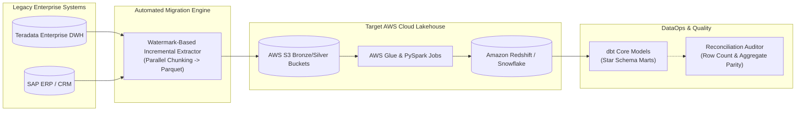

# Enterprise Cloud Data Migration & Modern ELT Platform

[](https://opensource.org/licenses/MIT)
[](https://www.python.org/downloads/)
[](https://aws.amazon.com/glue/)
[](https://aws.amazon.com/redshift/)
[](https://www.getdbt.com/)
[](https://www.terraform.io/)

> **Independent portfolio reference implementations** illustrating enterprise source-system modernization, parameterized incremental extraction, data reconciliation, and modern analytics design. Examples use synthetic or mock inputs rather than employer production data.

---

## Featured resume-aligned project

### [Enterprise Lakehouse Modernization & Governed AI-Ready Data Products](projects/enterprise-lakehouse-modernization/)

An **Azure Databricks / Delta Lake / dbt** reference project with a runnable Bronze → Silver → Gold transformation, synthetic data, validation and reconciliation tests, a customer-level mart, and CI checks on Python 3.10/3.12. The related Auto Loader, Unity Catalog, Terraform, and deployment architecture is documented as a design, not an active cloud deployment.

Run it from the repository root:

```bash
cd projects/enterprise-lakehouse-modernization
python -m unittest discover -s tests -v
python lakehouse.py sample_data/orders.json
```

## 🏗️ Architecture & Modernization Pipeline



---

## 🚀 Key Technical Highlights

* **Watermark-Based Incremental Extraction**: Builds advancing exclusive-inclusive windows as parameterized SQL statements so watermark values remain separate from SQL text. Table and column names are restricted to conservative simple or dot-qualified identifiers; equal, reversed, and incomparable bounds are rejected before execution.
* **Teradata/SAP modernization design**: Documents how relational, ERP, and CRM sources can feed cloud lakehouse architectures. This repository does not claim an active source connector or full proprietary datatype translator.
* **Automated Data Parity Reconciliation**: Checks exact row counts and financial aggregate totals. Counts must be non-negative integers; booleans and other count types are rejected. Totals must be finite integers, floats, or `Decimal` values; strings, booleans, and other types are rejected. The unrounded absolute difference must be strictly below `0.01`; use `Decimal` for database financial values. These aggregate checks do not establish row-level equality.
* **Analytical modeling patterns with dbt**: Includes example SQL models and dimensional schema structure; actual source integration needs warehouse credentials and environment configuration.
* **Infrastructure as Code (Terraform)**: Includes reference definitions for an AWS S3 bucket and Glue catalog database; Redshift and IAM end-to-end deployments are not included.

---

## 📂 Project Structure

```
enterprise-cloud-data-migration/
├── ci/ci.yml                          # Automated CI pipeline
├── dags/
│   └── migration_orchestration_dag.py # Airflow migration DAG
├── dbt_project/                       # dbt Core models
│   ├── dbt_project.yml
│   └── models/
│       ├── staging/
│       │   ├── stg_salesforce_accounts.sql
│       │   └── stg_erp_orders.sql
│       └── marts/
│           ├── fct_unified_sales.sql
│           └── schema.yml
├── docs/architecture.md               # Migration design specification
├── src/
│   ├── __init__.py
│   └── migration/
│       ├── incremental_extractor.py   # Watermark extractor
│       └── reconciliation_auditor.py  # Aggregate & row count parity
├── terraform/
│   ├── main.tf                        # S3, Glue, Redshift IaC
│   └── variables.tf
├── tests/
│   └── test_migration_pipeline.py     # Unit test suite
├── docker-compose.yml
├── requirements.txt
└── .gitignore
```

---

## ⚡ Quickstart

```bash
git clone https://github.com/devmasonmir/enterprise-cloud-data-migration.git
cd enterprise-cloud-data-migration
python -m venv venv
.\venv\Scripts\activate
pip install -r requirements.txt
python -m unittest discover -s tests -v
python -m src.migration.incremental_extractor
```

---

`build_extract_query` returns `(sql, parameters)`. Pass both parts to a database API that supports named `:parameter` binding; do not format the parameter values into the SQL string. Watermark bounds must be mutually comparable, and `current_watermark` must be strictly greater than `last_watermark`. The unit tests use only Python's standard library and can run before installing the cloud and dbt dependencies. Invalid row counts, unsupported total types, and NaN or infinite financial totals raise `ValueError` rather than producing an audit result.

## Scope and licensing

These are independent technical portfolio examples. No employer production data or live migrations are included. No license file is currently included in this repository.


