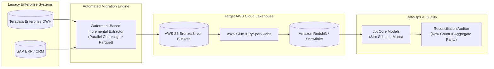

# Enterprise Cloud Data Migration & Modern ELT Platform

[](https://opensource.org/licenses/MIT)
[](https://www.python.org/downloads/)
[](https://aws.amazon.com/glue/)
[](https://aws.amazon.com/redshift/)
[](https://www.getdbt.com/)
[](https://www.terraform.io/)

> **Enterprise cloud platform modernization engine migrating on-premise monolithic data warehouses (Teradata, SAP ERP, Salesforce) to an AWS S3, Glue, and Redshift Lakehouse with automated incremental extraction, dbt transformations, and reconciliation audits.**

---

## 🏗️ Architecture & Modernization Pipeline



---

## 🚀 Key Technical Highlights

* **Watermark-Based Incremental Extraction**: Builds exclusive-inclusive windows as parameterized SQL statements so watermark values remain separate from SQL text. Table and column names are restricted to conservative simple or dot-qualified identifiers.
* **Teradata & SAP Schema Normalization**: Translates proprietary data types into open Parquet formats and ANSI SQL types.
* **Automated Data Parity Reconciliation**: Checks exact row counts and financial aggregate totals. Totals must be finite, and the unrounded absolute difference must be strictly below `0.01`. Accepts integers, floats, and `Decimal` values; use `Decimal` for database financial totals. These aggregate checks do not establish row-level equality.
* **Unified Analytical Modeling with dbt**: Consolidates fragmented CRM and ERP entities into high-performance dimensional models.
* **Infrastructure as Code (Terraform)**: Fully scripted infrastructure deployment for AWS S3, Glue catalogs, Redshift clusters, and IAM.

---

## 📂 Project Structure

```
enterprise-cloud-data-migration/
├── ci/ci.yml                          # Automated CI pipeline
├── dags/
│   └── migration_orchestration_dag.py # Airflow migration DAG
├── dbt_project/                       # dbt Core models
│   ├── dbt_project.yml
│   └── models/
│       ├── staging/
│       │   ├── stg_salesforce_accounts.sql
│       │   └── stg_erp_orders.sql
│       └── marts/
│           ├── fct_unified_sales.sql
│           └── schema.yml
├── docs/architecture.md               # Migration design specification
├── src/
│   ├── __init__.py
│   └── migration/
│       ├── incremental_extractor.py   # Watermark extractor
│       └── reconciliation_auditor.py  # Aggregate & row count parity
├── terraform/
│   ├── main.tf                        # S3, Glue, Redshift IaC
│   └── variables.tf
├── tests/
│   └── test_migration_pipeline.py     # Unit test suite
├── docker-compose.yml
├── requirements.txt
└── .gitignore
```

---

## ⚡ Quickstart

```bash
git clone https://github.com/devmasonmir/enterprise-cloud-data-migration.git
cd enterprise-cloud-data-migration
python -m venv venv
.\venv\Scripts\activate
pip install -r requirements.txt
python -m unittest discover -s tests -v
python -m src.migration.incremental_extractor
```

---

`build_extract_query` returns `(sql, parameters)`. Pass both parts to a database API that supports named `:parameter` binding; do not format the parameter values into the SQL string. The unit tests use only Python's standard library and can run before installing the cloud and dbt dependencies. NaN or infinite financial totals raise `ValueError` rather than producing an audit result.

## 📜 License
MIT License.
